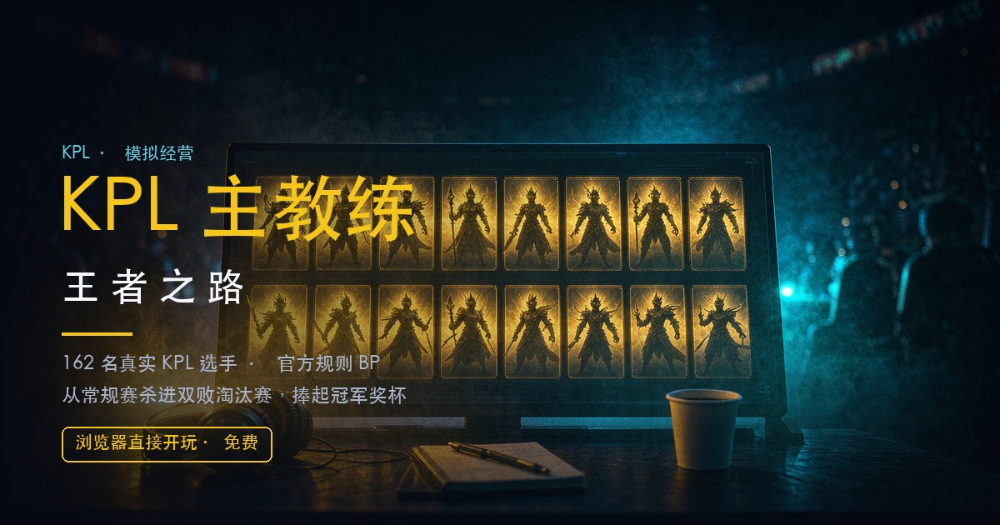

# KPL 主教练：王者之路



一款纯前端的 KPL 模拟经营游戏。你是战队主教练：选人、训练、转会、按官方规则 BP，带队从常规赛杀进双败淘汰赛，捧起冠军奖杯。

**🎮 在线试玩：<https://jasonzhang369.github.io/kpl-coach-simulator/>**

**无需安装、无需后端**——一个 `index.html` 打开就能玩，进度存在浏览器 localStorage。

---

## 玩法

**核心循环**：转会补强 → 训练/突破 → BP 选阵容 → BO5/BO7 系列赛 → 常规赛积分 → 季后赛双败淘汰 → 多赛季王朝。

| 系统 | 说明 |
|---|---|
| **BP** | 官方四阶段：4 ban + 10 选，红蓝方分配、蓝方先选、红方后手 Counter；**全局 BP**（本队用过的英雄后续局不可再选，按战队记，与红蓝方无关）；第 7 局巅峰对决为盲选、不受全局 BP 限制 |
| **英雄** | 112 个英雄分五路，含定位克制、英雄级克制、28 组组合体系（朵莉亚双大、盾山艾琳等） |
| **熟练度** | 每名选手对每个英雄有 0~100 熟练度，直接乘进战力（绝活 ≈×1.11 / 一般 ≈×1.02）；池外英雄按「会玩但不熟」计，不会因为全局 BP 打到第 3 局就崩 |
| **选手** | 162 名真实 KPL/K甲 选手，S/A/B/C 评级 + 总评；年龄、合同、成长上限、体能、状态（火热/低迷/伤病） |
| **体能** | 每局消耗、轮间恢复、全队休息（消耗训练点）、季后赛休整日；BO5 打满和 3:0 横扫的消耗不同，长赛季需要主动轮换 |
| **战术** | 三种战术（稳健/激进/奇袭）影响方差与战力；阵容判定会评价前排/输出/控制是否齐全 |
| **联赛** | 12 队单循环 11 轮，每轮所有队都打（AI 对局自动结算），前 4 进季后赛；双败淘汰，AI 战绩同样有资金/粉丝/声望变化 |
| **经营** | 转会市场（赛季初开放、每赛季 3 次）、赛中租借、青训、粉丝见面会、教练组（心理/体能/数据三项，一次性聘用费 + 每赛季工资）、董事会赛季目标 |
| **难度** | 只影响**对手的 BP 水平**（新秀/职业/传奇），不改任何战力；传奇与「真实大名单」禁用一键 BP |
| **存档** | 3 个槽位、可改名、导入/导出 `.json`、旧档自动迁移 |

**操作提示**：`1~8` 切页签 · `/` 聚焦搜索 · `B` 一键 BP · `S` 跳过战斗 · `R` 一键轮换 · `?` 帮助 · `Esc` 关弹窗。顶栏右侧还有 📖 游玩指南、⚙ 设置、🏠 返回首页。

---

## 音乐与音效

**全部是 Web Audio API 现场合成的**——仓库里没有任何音频文件，也不发网络请求，所以 `file://` 双击打开就有声音。

| 场景 | 曲目 |
|---|---|
| 主菜单 / 首页 | `menu` — 88 BPM，C 大调舒缓 |
| 常规赛 / BP / 战斗 | `match` — 116 BPM，A 小调 |
| **巅峰对决（第 7 局）** | `peak` — 150 BPM，D 小调，切分 + 警报音 |
| 总决赛夺冠 | `win` — 一次性短曲 |

音效：BP 禁用/选将、局内意外（抢龙/ACE/偷家）、系列赛胜负。

**想换成自己的巅峰对决 BGM**：把文件命名为 `audio/peak.mp3`（也支持 `.ogg/.m4a/.wav`）放进 `audio/` 目录，第 7 局会自动改用你的文件，其余场景仍用内置曲。没检测到就回退到合成曲，不会没声音。

> ⚠️ KPL 官方 BGM 有版权，不要随仓库公开分发。本仓库不带音频正是出于这个原因。

**设置面板（⚙）** 可以单独调：背景音乐开关+音量 · 音效开关+音量 · 总音量。设置存在 localStorage，对所有存档生效，切换后立即生效。

**游玩指南（📖）** 第一次开档会自动弹一次（8 步：开档→转会→训练→BP→比赛→季后赛→长期→目标），之后从顶栏随时可看。

**返回首页（🏠）** 会自动存档；如果系列赛没打完会先确认（避免误触丢比分）。


---

## 运行

三种方式都行，任选一种：

**1. 直接打开**
```
双击 index.html
```

**2. 本地服务器（推荐，避开个别浏览器对 file:// localStorage 的限制）**
```bash
python3 -m http.server 8000
# 打开 http://localhost:8000
```

**3. 在线玩**：把仓库推到 GitHub，开启 Pages 即可（见下）。

---

## 部署到 GitHub Pages

**本站已部署：** https://jasonzhang369.github.io/kpl-coach-simulator/

自己重新部署的话，仓库已经准备好（`main` 分支、`.nojekyll`、`.gitattributes`、`.gitignore`），push 上去即可：

```bash
git clone https://github.com/Jasonzhang369/kpl-coach-simulator.git
# 改完代码后
git add -A && git commit -m "你的改动" && git push
```

然后在仓库 **Settings → Pages** 里确认：

- **Source**：Deploy from a branch
- **Branch**：`main` / `(root)`
- 点 **Save**，等 1 分钟左右即可访问

纯静态、无构建步骤、无外部 CDN、零素材，推上去就能跑。

---

## 技术

- 纯原生 HTML / CSS / JavaScript，**零依赖、零构建、零素材**（图标是内联 SVG，音乐是程序合成）
- 五个模块按顺序加载：`js/data.js`（静态数据）→ `js/audio.js`（Web Audio 合成）→ `js/sim.js`（规则与模拟）→ `js/render.js`（渲染）→ `js/state.js`（状态/存档/交互）
- 存档：`localStorage`，3 槽位 + 导入导出，带版本号与迁移函数
- 无障碍：关键按钮有 `aria-label`，选手卡整卡可朗读，支持纯键盘操作

### 测试

自带无头测试（最小 DOM/localStorage 桩，直接加载 `js/*.js`），不需要装任何东西：

```bash
node tests/run.js           # 全部套件（189 项）
node tests/run.js econ      # 单个套件
node tests/audio-check.js   # 音频链路（假 AudioContext，约 1.5 秒）
```

当前 **189 项断言**，覆盖存档迁移、系列赛状态机、体能、年龄衰退、经济、BP 难度梯度、平衡回归、音频降级与设置/指南界面等。

---

## 目录结构

```
index.html              入口（5 个 script 按序加载）
style.css               全部样式
js/data.js              静态数据：英雄 / 组合 / 战队 / 真实选手池 / 克制表
js/audio.js             程序合成 BGM 与音效（Web Audio，无音频文件）
js/sim.js               规则与模拟：战力 / BP AI / 系列赛 / 经济 / 年龄 / 双败
js/render.js            渲染：页面 / 卡片 / BP 看板 / 战报 / 弹窗
js/state.js             状态与交互：存档 / 动作 / 键鼠事件 / 启动
audio/README.md         自定义巅峰对决 BGM 的放置说明
tests/                  无头测试（node tests/run.js）
.github/workflows/      推 main 自动部署 Pages
```

---

## 说明

- 选手 ID 与战队名取自 KPL 真实名单（2016–2026 各届大名单），**评级与总评是按历史战绩的民间评估，非官方数据**。
- 英雄定位、克制关系参考官方与社区资料，为游戏性做过简化。
- 本项目与腾讯、KPL 官方无关，仅供学习与娱乐。
- 代码以 **MIT** 许可开源（见 `LICENSE`）；文中出现战队名、选手 ID、英雄名的权利归各自所有者。
